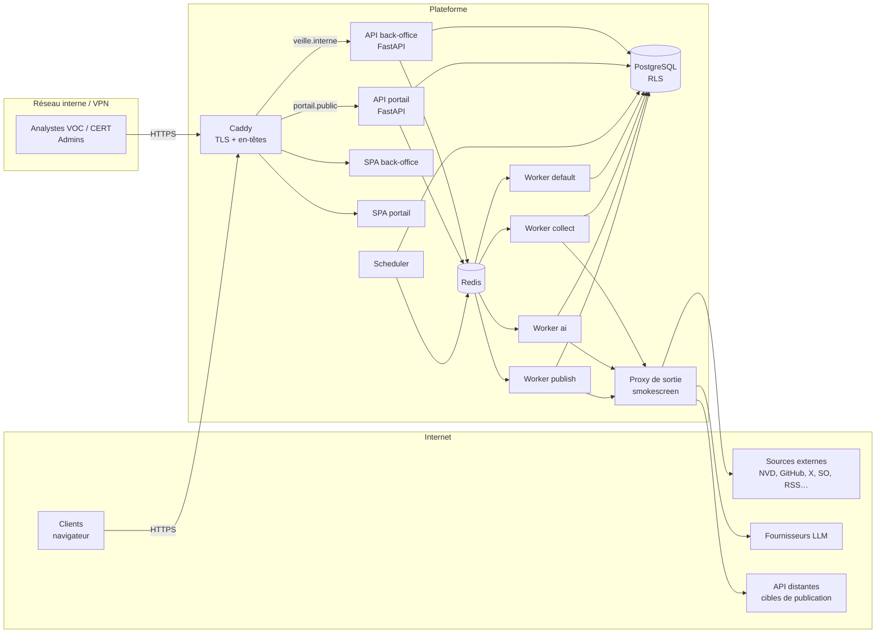
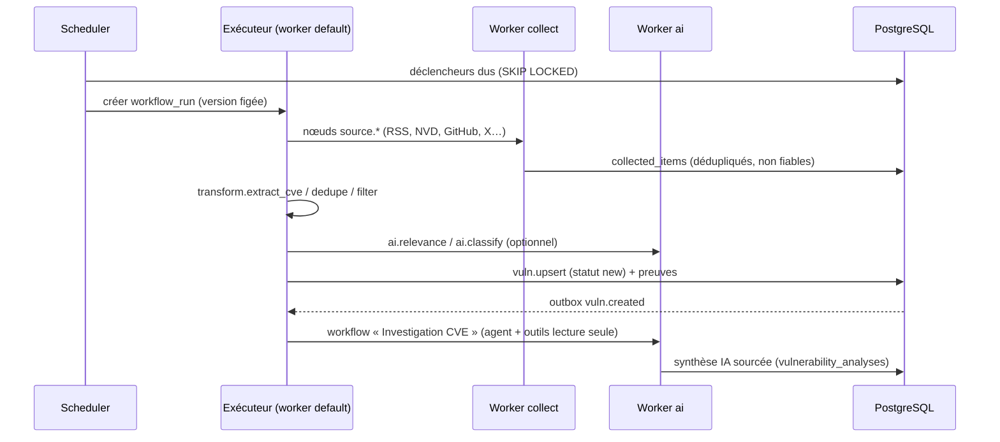

# ARCHITECTURE

## 1. Vue d'ensemble



Points structurants :

- **Deux applications ASGI** issues du même code : le back-office, réservé au réseau interne ou VPN, et le portail client, exposé sur Internet. Les routes back-office **n'existent pas** sur le portail. Les noms d'hôte, les cookies et les rôles de base de données sont distincts.
- **Deux SPA** séparées : le client ne télécharge jamais le code du back-office.
- **Workers spécialisés par file**. Chaque type de worker ne reçoit que les secrets nécessaires : collecte (secrets des sources), IA (clés LLM), publication (secrets des connecteurs).
- **Toute sortie réseau** des workers passe par le proxy smokescreen, qui bloque les plages internes ; le réseau Docker des workers n'a pas de route directe vers Internet.

## 2. Stack technique

Les versions exactes sont épinglées en phase 0, en prenant la dernière version stable publiée depuis au moins deux semaines.

### Backend

| Besoin | Choix |
|---|---|
| Langage | Python 3.13 |
| API | FastAPI, Uvicorn, Pydantic v2 (mode strict, `extra="forbid"`) |
| ORM et migrations | SQLAlchemy 2 (async, asyncpg), Alembic |
| Tâches | Celery 5 avec Redis (files `default`, `collect`, `ai`, `publish`) |
| Scheduler | Processus maison : `SELECT … FOR UPDATE SKIP LOCKED` sur les déclencheurs dus, calcul avec croniter |
| HTTP sortant | httpx avec transport personnalisé `SafeHttpClient`, tenacity pour les retries |
| Parsing | feedparser (sur octets déjà récupérés), selectolax ou BeautifulSoup, defusedxml |
| Gabarits | python-liquid (rendu sûr pour des gabarits édités par les utilisateurs) |
| Expressions | jmespath |
| Markdown | markdown-it-py (HTML brut désactivé) et nh3 (assainissement) |
| Sécurité | argon2-cffi, pyotp, webauthn (phase 10), cryptography (AES-GCM) |
| LLM | SDK officiel `anthropic` ; SDK `openai` pour les fournisseurs compatibles (Mistral, Azure, vLLM, Ollama) |
| Logs | structlog en JSON, OpenTelemetry (phase 10) |
| Outillage | uv, ruff, mypy strict, pytest, pytest-asyncio, testcontainers, schemathesis, bandit, pip-audit |

### Frontend

| Besoin | Choix |
|---|---|
| Base | TypeScript strict, React, Vite, pnpm workspaces |
| Routage et données | React Router, TanStack Query |
| Client API | Généré depuis OpenAPI (openapi-typescript et openapi-fetch) |
| Éditeur de workflows | @xyflow/react (React Flow) |
| Formulaires | react-hook-form et zod ; formulaires de nœuds générés depuis le JSON Schema (RJSF ou moteur maison léger, à trancher en phase 4) |
| Éditeurs de code | CodeMirror 6 (Liquid, JSON, JMESPath, Markdown) : léger et compatible avec une CSP stricte |
| UI | Tailwind CSS et shadcn/ui (Radix) |
| i18n | react-i18next (français par défaut) |
| Assainissement | DOMPurify, Trusted Types |
| Tests | Vitest, Testing Library, Playwright (E2E) |

### Infrastructure

| Besoin | Choix |
|---|---|
| Conteneurs | Docker, images minimales non-root, système de fichiers en lecture seule |
| Orchestration | Docker Compose (MVP) ; Helm/Kubernetes plus tard |
| Reverse proxy | Caddy 2 (TLS automatique ou certificats internes, en-têtes de sécurité) |
| Base de données | PostgreSQL 17 |
| Cache et file | Redis 7 (ou Valkey) |
| Proxy de sortie | smokescreen (Stripe), anti-SSRF au niveau réseau |
| E-mail en dev | Mailpit |
| CI | GitHub Actions |

## 3. Arborescence cible

```
Vuln-veille/
├── CLAUDE.md, README.md, Makefile, .env.example
├── .github/workflows/          # CI
├── backend/
│   ├── pyproject.toml, uv.lock, alembic.ini
│   ├── alembic/versions/
│   ├── app/
│   │   ├── main_backoffice.py   # ASGI back-office (routers internes)
│   │   ├── main_portal.py       # ASGI portail (routers portail uniquement)
│   │   ├── worker.py            # application Celery
│   │   ├── scheduler.py         # boucle des déclencheurs
│   │   ├── cli.py               # bootstrap admin, rotation des clés, maintenance
│   │   ├── core/                # config, db, logging, errors, pagination, security_headers,
│   │   │                        # crypto, http (SafeHttpClient), rate_limit, events (outbox)
│   │   ├── iam/                 # users, auth, mfa, sessions, csrf, rbac, workspaces, clients
│   │   ├── audit/
│   │   ├── secrets/
│   │   ├── catalog/             # CVE publiques : NVD, KEV, EPSS
│   │   ├── technologies/        # catalogue, demandes, abonnements
│   │   ├── collect/             # éléments collectés, adaptateurs de sources
│   │   ├── vulns/
│   │   ├── workflows/           # models, api, engine/, nodes/
│   │   ├── ai/                  # providers/, agents, runtime, tools/, guards
│   │   ├── bulletins/           # templates, drafting, rendering, lifecycle
│   │   ├── publishing/          # connectors, mapping, exports (csaf…)
│   │   └── portal/              # routes et schémas exposés aux clients
│   └── tests/{unit,integration,security}/
├── frontend/
│   ├── package.json, pnpm-workspace.yaml
│   ├── apps/backoffice/
│   ├── apps/portal/
│   └── packages/{ui,api-client,config}/
├── deploy/
│   ├── docker-compose.yml, docker-compose.dev.yml
│   ├── caddy/Caddyfile
│   ├── smokescreen/acl.yaml
│   └── postgres/init/          # création des rôles
└── docs/
```

Chaque module backend suit la même structure : `models.py` (ORM), `schemas.py` (Pydantic, entrées et sorties distinctes), `repository.py` (accès aux données, toujours avec un périmètre), `service.py` (règles métier), `api.py` (routes, permissions déclarées), `permissions.py`.

## 4. Multi-tenancy et cloisonnement

- Trois périmètres : **global** (plateforme, catalogues publics), **espace** (VOC, CERT…), **organisation cliente**.
- Toute table métier d'espace porte `workspace_id NOT NULL`. Toute table client porte `client_org_id`.
- Barrière 1 (code) : les repositories exigent un objet `Scope` construit à partir de la session ; aucune requête métier n'est possible sans lui.
- Barrière 2 (base) : RLS PostgreSQL. Chaque transaction fait `SET LOCAL app.workspace_ids = '…'` et `SET LOCAL app.client_org_id = '…'`, et les politiques filtrent dessus. Le rôle applicatif n'a pas `BYPASSRLS`.
- Barrière 3 (portail) : l'API portail se connecte avec le rôle `vv_portal`, qui ne peut lire que la vue `portal_bulletins_v` et les tables du portail (abonnements, demandes de technos de son organisation).
- Les données publiques (catalogue CVE, KEV, EPSS) sont globales et partagées : aucune raison de les dupliquer par espace.
- Le catalogue des technos est global : il sert au marquage par les analystes et aux abonnements des clients.

## 5. Événements et temps réel

- **Outbox transactionnelle** : les événements métier (`vuln.created`, `vuln.qualified`, `bulletin.approved`, `bulletin.published`…) sont écrits dans `outbox_events` dans la même transaction que la modification, puis un dispatcher les publie vers les déclencheurs de workflows et les notifications.
- **SSE** (Server-Sent Events) pour la progression des exécutions et de la génération des drafts : même origine, authentifié par le cookie de session, plus simple qu'une WebSocket.

## 6. Flux principaux

### 6.1 Collecte vers vulnérabilité non qualifiée



### 6.2 Demande unitaire de draft

1. L'analyste clique « Demander un draft » sur une vulnérabilité, ou saisit un CVE, des URL ou un texte libre.
2. Le modèle est proposé automatiquement selon les règles de sujet, et l'analyste peut le changer ou ajouter des consignes.
3. Une `draft_request` est créée, puis une tâche file `ai` construit le contexte (données CVE, preuves, synthèse IA, enrichissements) et appelle le LLM en sortie structurée selon le schéma dérivé des champs du modèle.
4. Le JSON est validé, puis rendu de façon déterministe avec le gabarit Liquid. La sortie du LLM est une **donnée**, jamais un gabarit.
5. Le bulletin est créé au statut `draft`, avec une révision 1 (auteur IA, trace de l'agent) ; la progression est diffusée en SSE.
6. L'analyste édite, soumet en relecture, un second analyste valide si la double validation est active, puis publie vers le portail et/ou pousse via un connecteur.

### 6.3 Publication via API distante

`bulletin approved` → choix du connecteur → construction du payload par mapping → dry-run (optionnel) → envoi par le worker `publish` (SafeHttpClient, clé d'idempotence) → journal `publications` → identifiant distant mémorisé pour les mises à jour suivantes.

## 7. Conventions d'API

- REST JSON, OpenAPI générée, préfixes `/api/v1` (back-office) et `/api/portal/v1` (portail).
- Erreurs au format RFC 9457 (`application/problem+json`), messages génériques côté client, détails uniquement dans les logs.
- Pagination par curseur, tailles de page bornées (100 au maximum).
- Horodatages en UTC ISO 8601, identifiants UUIDv7.
- Verrouillage optimiste (`version` ou `ETag`/`If-Match`) sur les objets édités à plusieurs (workflows, modèles, bulletins).
